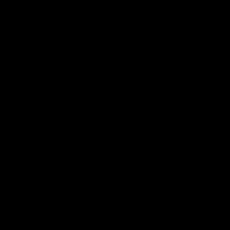

# LivingPixels

LivingPixels is a neural cellular automaton (NCA) that grows a small RGBA image from a single seed cell and attempts to regenerate it after local damage.



The project is an inspectable experiment rather than a black-box image generator. Every cell shares one local update rule, while hidden channels act as distributed memory.

## Demo

The browser demo supports pause/play, reset, button-based damage, and erasing cells with the mouse.

It also supports custom targets:

1. draw a 32x32 RGBA target in the **Draw target** canvas;
2. choose a brush color, brush size, or eraser;
3. click **Train drawn target**;
4. wait for the local Python API to train a new NCA;
5. reset or damage the resulting organism and observe regeneration.

The training request stays on the local machine. The browser sends only the 32x32 target to `serve_demo.py`; the user model is saved under `artifacts/user-model.npz`.

```powershell
python serve_demo.py
```

Open <http://127.0.0.1:8000/demo/>.

## Quick start

The project requires Python 3.10+, NumPy, and Pillow.

```powershell
python -m unittest discover -s tests -v

# Train a persistent-state model.
python train.py --pool --iterations 2000 --steps 64 --pool-size 512 `
  --output artifacts/livingpixels-pool.npz

# Export the checkpoint for the browser demo.
python export_web.py artifacts/livingpixels-pool.npz

# Generate a growth -> damage -> regeneration GIF.
python generate_gif.py artifacts/livingpixels-pool.npz

# Start the local demo server.
python serve_demo.py
```

Install Python 3.10+ and the dependencies with:

```powershell
python -m pip install numpy Pillow
```

## Architecture

The internal state has shape `B x 16 x 32 x 32`:

- channels `0:4` are rendered as RGBA;
- channels `4:16` are hidden state;
- perception contains identity, Sobel X, and Sobel Y responses;
- the shared update network is `48 -> 64 -> 16` with ReLU;
- the last layer starts at zero, so the initial rule is an identity update;
- cells update asynchronously with probability `p = 0.5`;
- a 3x3 alpha neighborhood controls which cells are alive and allowed to update.

## Training

The default target is a deterministic 32x32 pixel organism. Training uses truncated rollout backpropagation and Adam. Pool training keeps intermediate states between iterations, resets part of each batch to a fresh seed, and occasionally damages non-seed states.

```powershell
python train.py --pool --iterations 2000 --steps 64 `
  --pool-size 512 --batch-size 8 `
  --output artifacts/livingpixels-pool.npz
```

The implementation is intentionally NumPy-only for a small, reproducible baseline. A PyTorch implementation can be added later for GPU-scale experiments.

## Damage evaluation

The evaluation script measures final recovery after controlled damage. A trial counts as successful only when both conditions hold:

1. final RGBA MSE is below the configured threshold;
2. the recovered alpha mask retains at least half of the target area.

```powershell
python evaluate.py artifacts/livingpixels-pool.npz `
  --trials 100 `
  --output-dir artifacts/damage-sweep
```

The command writes `results.json`, `results.csv`, and `success-rate.svg`.

### Final 32x32 checkpoint

The published development run used seed `7`, 500 pool iterations, 32 rollout steps, a pool of 64 states, and batch size 4. The final no-damage preview loss was `0.039694`. The damage sweep used 20 trials per setting and 128 repair steps:

| Damage type | 10% | 25% | 50% | 70% |
| --- | ---: | ---: | ---: | ---: |
| Circle success rate | 100% | 100% | 100% | 15% |
| Random success rate | 100% | 100% | 100% | 100% |

The 70% circle result is included to show the current robustness boundary instead of hiding failure cases.

## Repository layout

```text
livingpixels/
  nca.py          # NCA state, perception, update, rollout, damage
  training.py     # manual backpropagation, Adam, pool training
  evaluation.py   # recovery criteria and damage sweep
  targets.py      # deterministic target organism
  web.py          # browser checkpoint serialization
train.py          # training CLI
evaluate.py       # evaluation CLI
generate_gif.py   # growth and regeneration animation
serve_demo.py     # static server plus local training API
demo/             # zero-dependency browser canvas demo
tests/            # regression and numerical smoke tests
```

## Limitations

This is a research prototype trained on one fixed target. It does not yet claim generalization to arbitrary images. The most interesting follow-up experiments are ablations of hidden channels and pool training, different update probabilities, and multiple target organisms.

## License

LivingPixels is licensed under the MIT License. See [LICENSE](LICENSE).

Third-party dependencies remain under their respective licenses.
